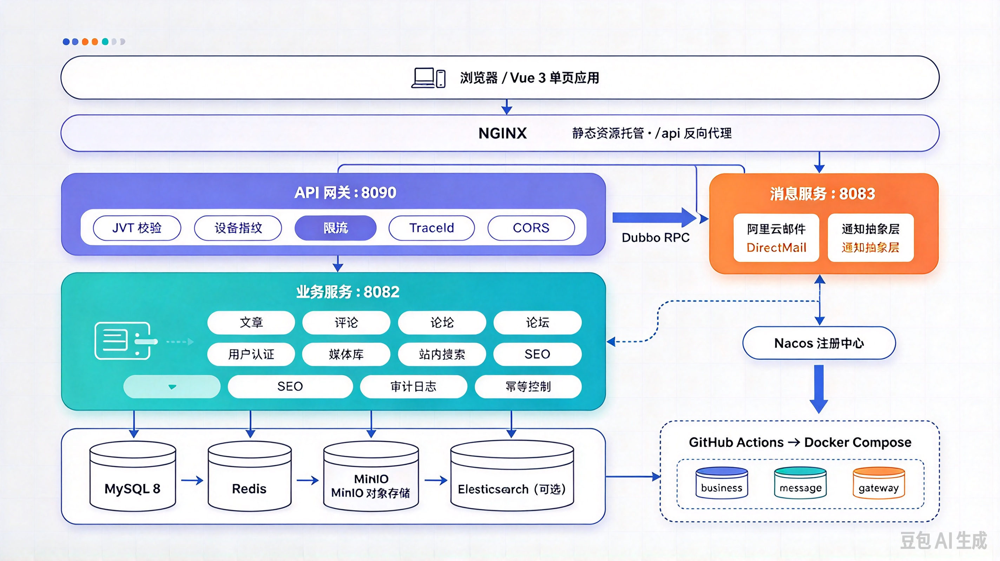

<div align="center">


<h1>OpenBlog</h1>

<p><strong>一个可以真正跑起来的全栈个人博客系统</strong><br />
Spring Boot 3 微服务后端 · Vue 3 前端 · business / message / gateway 三服务独立部署</p>

<p>
  <a href="https://github.com/yyyCode/OpenBlog/actions/workflows/ci.yml"></a>
  
  
  
  
</p>

<p>
  <a href="https://www.wecode.xin"><strong>在线体验</strong></a> ·
  <a href="https://github.com/yyyCode/OpenBlog/issues">问题反馈</a> ·
  <a href="docs/ROADMAP.md">路线图</a>
</p>

</div>

---

## 简介

OpenBlog 是一个用于学习与实践的个人博客系统，覆盖「写作 → 发布 → 互动 → 运营」的完整链路：文章、评论、论坛、媒体库、站内搜索、管理后台、SEO 和邮件通知都是真实落地的功能。

项目刻意采用**微服务**形态（business / message / gateway + Dubbo + Nacos），把消息异步化、网关鉴权、幂等去重、审计这些通常只在更大体量下才会遇到的问题，在个人项目的规模里走了一遍。它更适合作为可读、可改、可拆的工程范本，而不是开箱即用的商业成品。

## 功能

| 模块 | 能力 |
| --- | --- |
| 内容 | 文章（草稿 / 发布 / 定时 / 隐藏）、Markdown、分类标签、站内搜索、更新日志、Bug 案例 |
| 媒体 | MinIO / 本地磁盘、拖拽上传、缩略图、WebP 转换、删除前引用校验 |
| 互动 | 评论回复（级联软删、双击幂等）、论坛（敏感词过滤）、点赞 / 收藏 / 关注 |
| 账号 | JWT + `ADMIN / AUTHOR / READER` 三级角色、邮箱验证码（Dubbo 投递）、设备指纹防护 |
| 治理 | 管理后台、审计日志、幂等框架、通知抽象层、SEO（SSR + sitemap） |

## 技术栈

- **后端**：Java 17 · Spring Boot 3.5 · Spring Cloud 2025 · MyBatis-Plus + JPA · Dubbo + Nacos · JWT · Thymeleaf
- **数据**：MySQL 8 · Redis（Redisson）· MinIO · Elasticsearch（可选）
- **前端**：Vue 3 · Vue Router 4 · Vite 8 · marked + DOMPurify · FingerprintJS
- **部署**：Maven 多模块 · Docker Compose · Nginx · GitHub Actions

## 架构



浏览器 → Nginx（托管 `vue/dist`，`/api` 反代）→ gateway :8090（JWT · 设备指纹 · 限流 · traceId）→ business :8082；business 与 message :8083 通过 **Nacos** 注册发现、以 **Dubbo** 互通，邮件、验证码等耗时链路都从主业务链路里摘了出去。数据层为 MySQL 8 · Redis · MinIO · Elasticsearch（可选）。

更多设计图见 [`docs/architecture/`](docs/architecture/)。

## 快速开始

环境：JDK 17+ · Maven 3.9+ · Node 18+ · MySQL 8 · Redis 6+（端口 6739）· Nacos 2.x。MinIO、阿里云 DirectMail 可选。

```bash
# 1. 建库并导入 sql/（migrate- 前缀为增量迁移，按顺序执行）
mysql -uroot -p -e "CREATE DATABASE openblog DEFAULT CHARSET utf8mb4"

# 2. 可选：复制本地配置模板（已被 git 忽略）
cp OpenBlog-business/src/main/resources/application-local.example.yaml \
   OpenBlog-business/src/main/resources/application-local.yaml

# 3. 启动后端（本地配置追加 -Dspring-boot.run.profiles=local）
mvn spring-boot:run -pl OpenBlog-message    # :8083
mvn spring-boot:run -pl OpenBlog-business   # :8082

# 4. 启动前端
cd vue && npm install && npm run dev        # http://localhost:5173
```

> 中间件默认指向内网开发机，本地运行请用 `application-local.yaml` 或环境变量覆盖。

关键环境变量：`OPENBLOG_JWT_SECRET`（business / gateway 两端必须一致）、`OPENBLOG_DEVICE_TOKEN_SECRET`（gateway）、`ALIYUN_AK/SK/FROM`（message）。

## 部署

> [!IMPORTANT]
> business ↔ message 通过 Dubbo 调用、business ↔ gateway 共用 JWT 密钥——涉及任一耦合的改动，三服务必须同步部署，否则 Nacos 里的 provider / consumer 对不上。

```bash
mvn -pl OpenBlog-business -am package -DskipTests   # :8082
mvn -pl OpenBlog-message  -am package -DskipTests   # :8083
mvn -pl OpenBlog-gateway  -am package -DskipTests   # :8090
```

前端 `npm run build` 产出 `dist/` 交 Nginx 托管；推送 master 后 GitHub Actions 按变更链路自动构建部署。Docker 化说明见 `deploy/`。

## 文档

- [CLAUDE.md](CLAUDE.md) — 开发规范、常用命令、提交 / PR 规则
- [ROADMAP](docs/ROADMAP.md) — 规划与进度
- [踩坑记录](docs/evolution/dev-experiences.md) · [安全加固](docs/evolution/security-hardening.md) · [设备指纹](docs/evolution/设备指纹合法性-网关侧校验与防构造.md) · [网关设计](docs/designs/api-gateway-security-ha.md) · [幂等框架](docs/superpowers/specs/2026-08-29-idempotent-framework-design.md)

## 贡献

从 `master` 切 `<type>/<slug>` 分支，用中文 conventional commit 提交；提交前跑通 `mvn -pl <module> -am package` 与 `cd vue && npm run build`；一律走 PR，merge commit 合并。细节见 [CLAUDE.md](CLAUDE.md)。

## 许可证

仓库暂未附带 `LICENSE` 文件，默认保留所有权利。使用、分发或二次开发前，请先联系维护者确认授权范围。

---

<div align="center">

<sub>如果这个项目对你有帮助，欢迎点一个 Star</sub>

</div>
